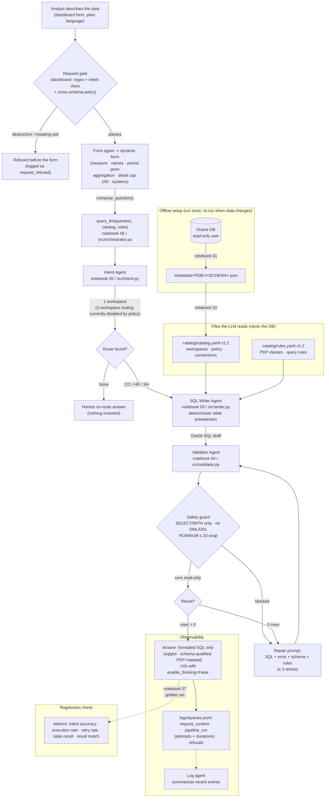

# QueryLLM

A multi-agent text-to-SQL system for Oracle databases, built for a data
engineer who translates analyst questions into SQL. The analyst describes
what they need in plain language in the dashboard; a request gate filters
destructive asks, a dynamic form captures the details, and the chat replies
with the final SQL only - formatted, schema-qualified, PDP-anonymized, in
~10 seconds. No schema, table or column names are ever shown to the analyst.

The whole system is a series of Jupyter notebooks (01–07) that publish shared
code into `src/`, plus a Streamlit dashboard in `dashboard/`.

## Pipeline end-to-end



Key properties:

- The LLM never touches Oracle and never sees row values — only catalog +
  rules text.
- PDP-classified columns (rules.yaml) are anonymized in the result, never
  refused (SPECIFIC → aggregates only, DIRECT → masked, INDIRECT → generalized).
- Cross-schema joins are **currently disabled by catalog policy**
  (`cross_schema_joins: disallowed`): the candidate connections are recorded
  but not trusted as join evidence — re-enable by flipping
  `CROSS_SCHEMA_DISABLED = False` in notebook 02 when verified cross-schema
  FKs exist.
- All SQL execution is wrapped: `SELECT/WITH`-only guard, no write/DDL
  keywords, `ROWNUM <= 20` cap.
- Speed: the writer/validator run with `enable_thinking=False` (qwen3.8-flash
  otherwise generates ~12k hidden reasoning tokens — 90% of the latency);
  the intent agent keeps thinking ON for routing accuracy. Per-stage
  `durations` are recorded in every log record.

## Repository layout

```
notebook/           01_extract_metadata   Oracle -> metadata/<PDB>/<SCHEMA>.json
                    02_catalog            metadata -> catalog/catalog.yaml (generated)
                    03_sql_writer         SQL writer agent (first definitions)
                    04_validator          safety guard + repair loop (first definitions)
                    05_intent_agent       question -> workspace routing (first definitions)
                    06_queryllm           query_llm() orchestrator (first definitions)
                    07_evaluate           golden-set evaluation harness
dashboard/          Streamlit form-based chat UI (own src/, own .env)
src/                GENERATED by the notebooks' export cells - do not hand-edit
catalog/            catalog.yaml (generated) + rules.yaml (hand-edited config)
metadata/           generated extraction output
docs/               ARCHITECTURE.md - how the pieces fit
.env.example        environment template (keys only)
requirements.txt    pinned dependencies of the fdr-text2sql conda env
```

## Setup

1. Python 3.12 conda env (name: `fdr-text2sql`), then:

   ```
   pip install -r requirements.txt
   ```

2. Environment variables (see `.env.example`; never commit real values):

   ```
   ORA_USER / ORA_PASSWORD / ORA_DSN / PDB_NAME   # Oracle extraction connection
   SQL_AGENT                                      # LLM API key
   LLM_URL                                        # chat-completions endpoint
   LLM_MODEL                                      # e.g. qwen3.8-flash
   ```
