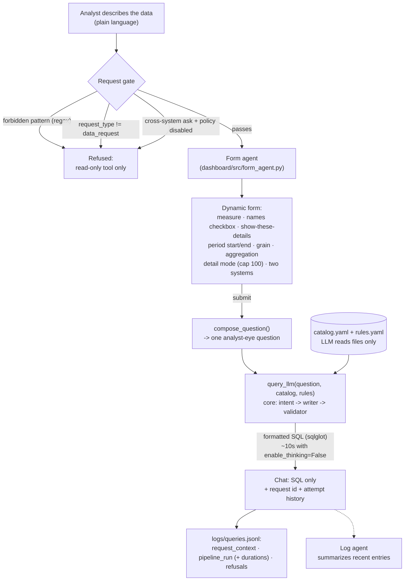

# QueryLLM dashboard

A form-based chat UI on top of the QueryLLM pipeline. The analyst describes
the data they need in plain language; a request gate filters destructive or
mutating asks; a small dynamic form captures the details (what to measure,
human-readable names, period, grain, aggregation or detail mode, the two
systems for cross-domain asks); the chat replies with the final SQL only -
formatted, schema-qualified, PDP-anonymized - typically in ~10 seconds. The
analyst copies it and runs it in their own SQL client.

## Flow



## What it does (one line per piece)

| Piece | Job |
|---|---|
| `app.py` | Streamlit entry: chat thread, request gate, dynamic form, formatted SQL-only answers |
| `src/form_agent.py` | description -> form spec (LLM), form -> one analyst-language question, forbidden-request + cross-system gate |
| `src/sql_format.py` | pretty-prints the SQL shown in the chat (log keeps the raw model output) |
| `src/logging_utils.py` | appends every request to `logs/queries.jsonl` (pretty JSON, `---` separated) |
| `src/log_agent.py` | LLM agent that summarizes recent log entries for the data engineer |
| `src/` | dashboard-only helpers - never merged with the core QueryLLM `src/` |

No preview rows and no charts are shown; the query result stays in the
analyst's SQL client.

## Request gate

Destructive or mutating asks (drop, recreate, delete, truncate, wipe, ...)
are refused BEFORE the form appears, in two layers:

1. deterministic forbidden patterns (no LLM call) - worded as intent
   combinations so benign lookalikes ("create a monthly report") pass
2. the form agent classifies `request_type`: anything other than
   `data_request` (schema_change / data_change) is refused

Refusals are logged as `kind: request_refused` so the log agent reports
"refused at the gate" instead of a suspicious hole.

Cross-system asks are also refused while the catalog policy disables
cross-schema matching (`cross_schema_joins: disallowed`) - the policy is the
data engineer's decision, recorded in `catalog/catalog.yaml`.

## Logs

Two records per request in `logs/queries.jsonl` (gitignored - contains
analyst questions):

1. `request_context` - what the analyst described + the form spec
2. `pipeline_run` - composed question, routed workspaces, the schema text
   the model saw (`schema_objects_shown`), every SQL attempt with its
   outcome, the final SQL (formatted + raw), and per-stage `durations`
   (intent / write / validate seconds)

Each record carries a short `request_id` also shown under the SQL in the UI,
so a human can grep the log for one exact request. Row data is never logged.
"Summarize recent log entries" in the sidebar asks the log agent to digest
the last 5 records.

## Run

```
<conda-env>/bin/streamlit run dashboard/app.py
```

Requirements:
- `dashboard/.env` (separate from the root `.env`; see `.env.example` — the
  dashboard loads it first, root `.env` is the fallback)
- `catalog/catalog.yaml` + `catalog/rules.yaml` exist (run notebook 02 first)
- The core `src/` package is importable (regenerated by notebooks 03-06)

## Notes

- Detail mode ("all rows") bakes `FETCH FIRST 100 ROWS ONLY` into the
  generated SQL.
- Every query is validated statically before it is shown: guard + Oracle
  parse + catalog identifier consistency - the web pipeline NEVER executes
  SQL and NEVER connects to the database (ORA errors cannot happen here;
  the analyst runs the SQL in their own client).
- `dashboard/.env` is LLM-only: no Oracle credentials exist on this server.
- The LLM reads only `catalog.yaml` + `rules.yaml` - never row data.
- Speed: the writer/validator run with `enable_thinking=False` (qwen3.8-flash
  generates ~12k hidden reasoning tokens otherwise - 90% of the latency);
  the intent agent keeps thinking ON for routing accuracy. Relative dates
  ("last year") are resolved from the DATA via a `rules.yaml` rule, not from
  SYSDATE.
