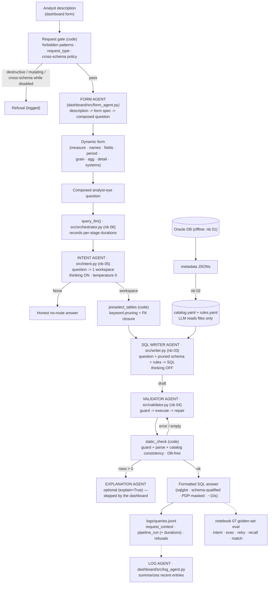

# QueryLLM Architecture

## What it is

A multi-agent text-to-SQL pipeline for Oracle databases. Analysts describe
what they need in plain language in the Streamlit dashboard (description →
dynamic form → SQL only, no preview/explanation shown); a data engineer
operates the pipeline. The LLM only ever reads files (catalog + rules); all
SQL execution happens behind a read-only guard, in the notebook or the
dashboard server. Core entry point: `query_llm(question, catalog, rules)` in
`src/orchestrator.py`; dashboard entry point: `dashboard/app.py`.

## Data / control flow

```
Oracle DB
   │  (notebook 01, oracledb thin mode, read-only user)
   ▼
metadata/<PDB>/<SCHEMA>.json     tables, views, MVs, columns, PK/FK
   │  (notebook 02: normalize + auto-detect cross-schema connections)
   ▼
catalog/catalog.yaml  v1.2       workspaces (one per schema), policy,
   │                             connections (candidate cross-schema links)
   │  + catalog/rules.yaml (hand-edited)  PDP classification hints + query rules
   ▼
src/ (generated by export cells) llm, rules, writer, validator, intent, orchestrator
   │
    ├── notebook 03  SQL writer   question + pruned workspace schema + rules -> SQL
    ├── notebook 04  validator    guard -> run read-only -> repair loop (max 3)
    ├── notebook 05  intent       question -> 1 workspace (2-workspace routing
    │                              dormant while policy disables cross-schema)
    └── notebook 06  query_llm()  intent -> writer -> validator -> explanation (optional)
    ▼
answer: formatted SQL only via the dashboard (sqlglot-pretty, schema-qualified,
PDP-masked, ~10s); preview rows + plain-language explanation only in notebook
use (explain=True)

notebook 07 = golden-set harness: runs the same pipeline over known questions
and reports intent accuracy / execution rate / retry rate / table recall /
result match. Run it after every change to a prompt, the catalog or rules.
```

## The isolation rule

`llm()` (src/llm.py) sends only prompt text built from `catalog.yaml` +
`rules.yaml`. It never touches the database and never sees row data. Only
`execute_readonly()` (src/validator.py) connects to Oracle: SELECT/WITH-only
guard, write/DDL keyword block, `SELECT * FROM (...) WHERE ROWNUM <= 20` wrap.

## Speed design (enable_thinking)

`llm()` sends `"enable_thinking": False` by default: qwen3.8-flash otherwise
generates ~12k hidden reasoning tokens per call, which was 90% of the latency
(55s → 4–6s per writer call). The ONE exception is the intent agent, which
passes `enable_thinking=True` — its reasoning chain is short and measurably
improves routing accuracy. Relative dates ("last year") are resolved from the
DATA via a `rules.yaml` rule (MAX of date/year columns), never from SYSDATE,
so the writer does not need reasoning for them. Per-stage durations
(intent/write/validate) are recorded in every `pipeline_run` log record.

## Cross-schema policy (derived, never assumed)

`policy.cross_schema_joins` is computed by notebook 02 from the data:
- verified cross-schema FKs exist → `verified_fk_only`
- else candidate connections (same-named tables) → `catalog_connections_only`
- neither → `disallowed`

**Currently DISABLED by DE decision** (`CROSS_SCHEMA_DISABLED = True` in
notebook 02): the pairs share no usable keys in practice (CO↔SH: different
key names, zero name overlap; HR↔SH: name-match only), so the policy is
`disallowed` and the three candidate connections stay recorded as evidence
for the future. When policy allows it, the intent agent may route to 2
workspaces only when `catalog.connections` links them, and the writer joins
only via the recorded `join_key` (or compares descriptively when it is
`unresolved`). Nothing is invented.

## PDP handling (no refusal, no approval gates)

`rules.yaml` classifies columns by name patterns: SPECIFIC → aggregate only
(min group 5), DIRECT → mask/token in the result, INDIRECT → generalize. The
schema block tags each column (`EMAIL_ADDRESS VARCHAR2 [DIRECT]`) so the model
writes compliant SQL on the first attempt; the validator repairs otherwise.

## Where to add things

| Task | Do this |
|---|---|
| New database/schema | run notebook 01, then 02 (catalog + connections regenerate) |
| New agent function | define it in full in ONE notebook; add an export cell that writes its module to `src/` |
| Change an existing agent | edit the defining notebook (03/04/05/06) and re-run it — export cell regenerates `src/` |
| New compliance/query rule | edit `catalog/rules.yaml` (hand-edited; comments required) |
| New golden question | append to `GOLDEN_SET` in notebook 07, with expected workspaces/tables (+ golden SQL when known) |
| New workspace description | edit the curated dict in notebook 02, re-run |

## Notebook execution

Use the `fdr-text2sql` conda env python with nbclient (no `jupyter nbconvert`
installed). Order matters: 01 → 02 → (03/04/05 in any order) → 06 → 07.
Notebooks 03/04/05/06 each end with an export cell that regenerates `src/`.

## The agents

Six LLM agents (each = one job + one `llm()` call), supported by deterministic
code that never calls the LLM:

| # | Agent | Lives in | Job | Thinking |
|---|---|---|---|---|
| 1 | Intent | src/intent.py (nb 05) | question → 1 workspace | ON |
| 2 | SQL Writer | src/writer.py (nb 03) | question + pruned schema + rules → Oracle SQL | OFF |
| 3 | Validator | src/validator.py (nb 04) | guard → execute → repair loop (≤ 3) | OFF |
| 4 | Explanation | src/orchestrator.py (nb 06) | SQL → plain language (optional, `explain=True`) | OFF |
| 5 | Form | dashboard/src/form_agent.py | description → form spec + composed question + gate classification | OFF |
| 6 | Log | dashboard/src/log_agent.py | summarizes logs/queries.jsonl for the DE | default |

Deterministic support code (no LLM): request gate patterns, `preselect_tables`
(keyword pruning + FK closure), `is_safe_sql` + `static_check`,
`pdp_class` (column classification), `render_rules` + `schema_block`,
`format_sql` (sqlglot display formatting).


